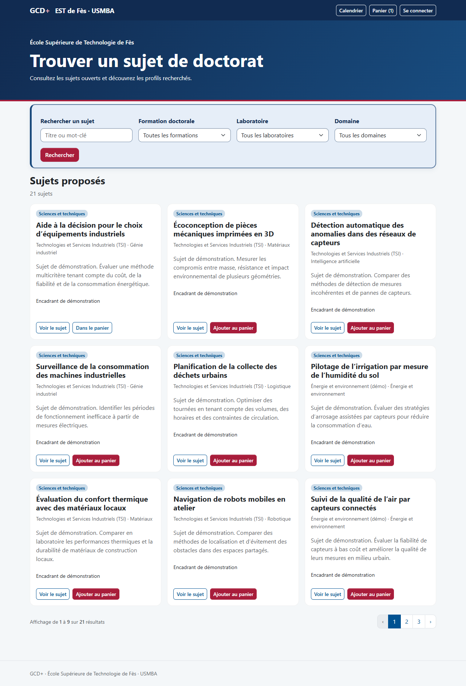

<p align="center">
  
</p>

# GCD+ · Gestion du cycle doctoral

Application de gestion du cycle doctoral développée dans le cadre de l’atelier O&M Développement Logiciel et adaptée au contexte de l’École Supérieure de Technologie de Fès (USMBA). GCD+ accompagne le candidat depuis la recherche d’un sujet jusqu’à l’inscription administrative, puis le doctorant dans sa réinscription annuelle.

**[Accéder à la démonstration en ligne](https://gcd-plus-estf.freehosting.dev)**

La démonstration utilise des identités, des sujets et des pièces fictifs. Elle est hébergée sur une adresse indépendante du projet ESThèque. Le logo GCD+ et l’interface reprennent une palette bleue et rouge ; le logo de l’application apparaît également dans l’onglet du navigateur.



## Fonctionnalités

### Catalogue public et panier

- Consulter les sujets et leurs détails sans se connecter.
- Rechercher par titre ou mot-clé et filtrer par formation doctorale, laboratoire et domaine.
- Voir les filtres actifs, réinitialiser la recherche et parcourir neuf sujets par page.
- Ajouter des sujets au panier avant la connexion et retrouver sa sélection après connexion.
- Consulter le calendrier des campagnes. Le jeu de démonstration contient 21 sujets.

### Compte et candidature

- Créer un compte candidat avec une adresse e-mail et un mot de passe.
- Utiliser une seule page de connexion pour tous les comptes, avec redirection automatique vers l’espace autorisé.
- Remplir les informations personnelles et académiques, déposer les justificatifs et compléter le dossier de candidature.
- Envoyer au maximum trois candidatures par campagne. Le serveur contrôle aussi les doublons, l’ouverture des sujets et les dates de campagne.
- Suivre ses candidatures dans le tableau de bord, consulter l’historique et identifier la prochaine action attendue.

### Documents et corrections

- Importer un PDF ou scanner un document avec la caméra du navigateur.
- Prévisualiser une capture, l’agrandir, la faire pivoter ou la reprendre avant l’envoi.
- Réunir plusieurs pages, par exemple un recto verso, dans un seul PDF.
- Demander une correction ciblée et accéder directement au dépôt de la pièce à remplacer.
- Consulter les documents privés uniquement avec les autorisations correspondantes.

Le scan nécessite l’autorisation de la caméra et une connexion HTTPS, ou un accès local via `localhost` ou `127.0.0.1`.

### Sélection, inscription et réinscription

- Examiner les dossiers affectés, demander des compléments et suivre les étapes de sélection, dont l’oral et la liste d’attente.
- Consigner les décisions d’acceptation ou de refus et contrôler les pièces de l’inscription administrative.
- Confirmer une inscription puis ouvrir le parcours de réinscription annuelle.
- Déposer un bilan annuel, recueillir les avis et accords, traiter les corrections et prendre la décision de réinscription.
- Traiter les demandes de prolongation avec l’accord du chef d’établissement prévu dans le circuit.

## Rôles et espaces

Chaque compte ouvre son propre tableau de bord. Les fonctions du personnel sont affectées par sujet ; les opérations accessibles dépendent de cette affectation et de l’état du dossier.

| Rôle | Principales responsabilités |
| --- | --- |
| Candidat / doctorant | Profil, pièces, candidatures, suivi, inscription et demandes de réinscription. |
| Directeur de thèse / encadrant | Proposition de sujets, suivi des candidatures et avis sur les réinscriptions. |
| Co-encadrant | Consultation des sujets et dossiers associés à son affectation. |
| Responsable de la structure de recherche | Avis et accords sur les sujets et réinscriptions de sa structure. |
| Directeur du CED | Avis et accords sur les sujets et réinscriptions de son périmètre. |
| Commission de sélection | Examen des candidatures, corrections de pièces, oral et décisions de sélection. |
| Comité de thèse | Avis sur le bilan annuel et la réinscription du doctorant suivi. |
| Chef d’établissement | Accord de l’établissement et décision sur les demandes de prolongation. |
| Gestionnaire ESTF | Contrôle des pièces, confirmation des inscriptions et traitement administratif des réinscriptions. |
| Administrateur | Gestion des comptes, affectations, formations, sujets et périodes de campagne. |

## Technologies

- Laravel 12 et PHP 8.2 ou supérieur.
- Vues Blade, Bootstrap 5 et compilation des ressources avec Vite.
- SQLite pour le démarrage local ; MySQL pour la démonstration hébergée.
- Stockage privé des documents et contrôle des accès côté serveur.

## Installer et lancer en local

Prérequis : accès à ce dépôt privé, Git, PHP 8.2 ou supérieur avec PDO SQLite, Composer et Node.js 22.12 ou supérieur sur la branche 22, ou une branche LTS plus récente.

```bash
git clone https://github.com/Hamza-Tazi-212/GCD-plus.git
cd GCD-plus
composer install
php -r "file_exists('.env') || copy('.env.example', '.env');"
php artisan key:generate
php -r "file_exists('database/database.sqlite') || touch('database/database.sqlite');"
php artisan migrate
npm ci
npm run build
php artisan db:seed
php artisan serve
```

Conserver `APP_ENV=local` et `DB_CONNECTION=sqlite` dans `.env`. Ouvrir ensuite [GCD+ en local](http://127.0.0.1:8000). Si le port 8000 est occupé, utiliser par exemple `php artisan serve --port=8026` et ouvrir l’adresse affichée.

Pour modifier l’interface pendant le développement, lancer `npm run dev` dans un second terminal à la place de la compilation ponctuelle avec `npm run build`.

### Préparer les comptes de démonstration locaux

Dans `.env`, renseigner `GCD_DEMO_PASSWORD` avec un mot de passe local d’au moins 12 caractères, puis exécuter :

```bash
php artisan db:seed --class=ExamDemoSeeder
```

Ce jeu d’essai s’exécute uniquement en environnement `local`. Il prépare dix comptes avec des identités et des pièces fictives et attribue le mot de passe choisi aux comptes de démonstration. Relancer cette commande réapplique ce mot de passe aux comptes concernés.

| Compte fictif | Espace |
| --- | --- |
| `candidat@demo.estf.example` | Candidatures, pièces et réinscriptions |
| `encadrant@estf.example` | Sujets et avis de l’encadrant |
| `admin@demo.estf.example` | Administration |
| `co_supervisor@demo.estf.example` | Co-encadrement |
| `lab@demo.estf.example` | Structure de recherche |
| `ced@demo.estf.example` | Centre d’études doctorales |
| `selection@demo.estf.example` | Commission de sélection |
| `thesis@demo.estf.example` | Comité de thèse |
| `head@demo.estf.example` | Chef d’établissement |
| `manager@demo.estf.example` | Gestionnaire ESTF |

Les mots de passe de la démonstration en ligne sont transmis séparément. Aucun mot de passe, fichier `.env`, identifiant d’hébergement ou document privé d’accès n’est inclus dans ce README.

## Vérifications réalisées

Les contrôles ci-dessous concernent la version vérifiée lors de la préparation et de la mise en ligne du 19 novembre 2026 ; ils ne constituent pas une surveillance continue du site.

- **Tests Laravel locaux :** 37 tests réussis, couvrant notamment le panier après connexion, le quota de candidatures, les permissions, les corrections, les validations et la pagination filtrée.
- **Parcours navigateur locaux :** catalogue en vue mobile et scan recto verso avec une caméra simulée ; PDF de deux pages et conservation de la rotation appliquée.
- **Démonstration en ligne :** catalogue, recherche, neuf sujets sur chacune des deux premières pages, panier invité et connexion obligatoire pour postuler.
- **Accès en ligne :** connexion aux dix espaces, lecture autorisée d’un PDF personnel du candidat et blocage des chemins privés de configuration et de stockage.
- **Icône du navigateur :** chargement contrôlé sur l’accueil, la connexion, une page d’erreur et un tableau de bord connecté.

Pour relancer la suite automatisée dans une installation locale disposant des dépendances de développement :

```bash
php artisan test
```

Le contrôle avec une caméra simulée ne remplace pas un essai sur chaque téléphone ou navigateur utilisé pour scanner les documents.

## Hébergement et limite actuelle

La démonstration est publiée en HTTPS sur [gcd-plus-estf.freehosting.dev](https://gcd-plus-estf.freehosting.dev), avec une base MySQL et une configuration de production distincte de la configuration locale. L’icône du navigateur reprend le symbole du logo GCD+.

**L’envoi réel d’e-mails reste à configurer.** La démonstration utilise `MAIL_MAILER=log` : les messages sortants sont journalisés et ne sont pas livrés aux destinataires. Les notifications internes restent disponibles. Un service de messagerie doit être configuré avant de s’appuyer sur l’envoi d’e-mails, notamment pour la réinitialisation du mot de passe.

## Documentation et diagrammes

- [Déroulement du développement](docs/gcd-plus/developpement.md) : adaptation de CDOC, parcours candidat, rôles et améliorations.
- [Diagrammes de GCD+](docs/gcd-plus/diagrammes/README.md) : cas d’utilisation, classes, activités, séquence de candidature, états et architecture, avec sources PlantUML et rendus SVG.
- [TP 5 et diagrammes de conception](docs/tp-seance-5/README.md).
- [Tableau comparatif des pistes d’amélioration](docs/tableau-comparatif-gcd.pdf), utilisé comme source d’idées pour l’expérience utilisateur.
